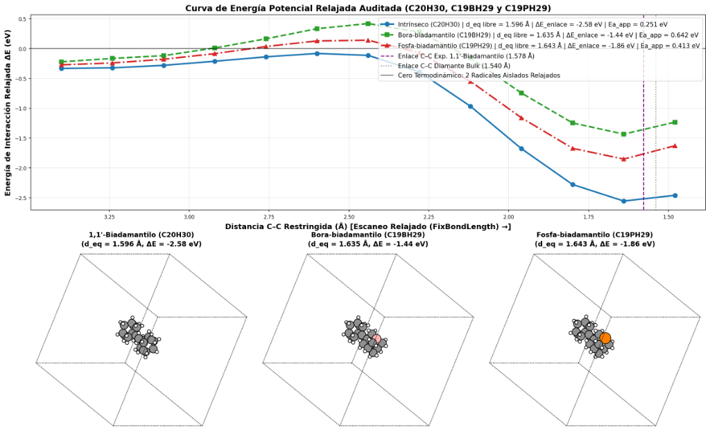
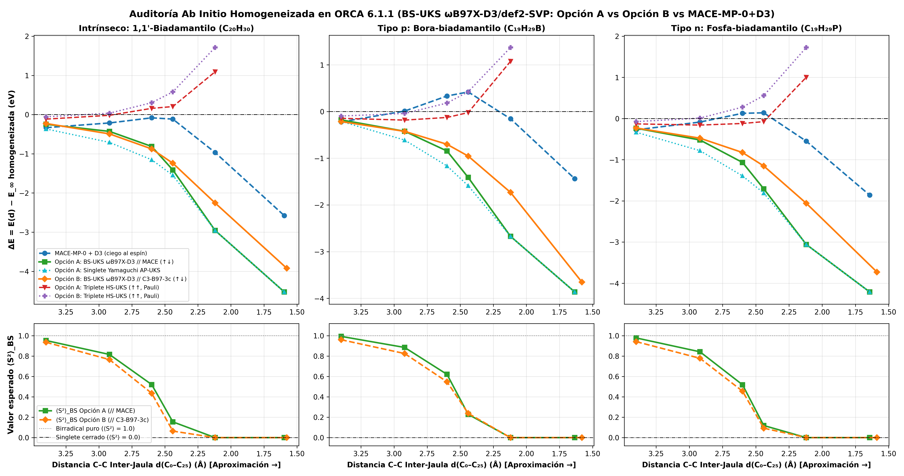
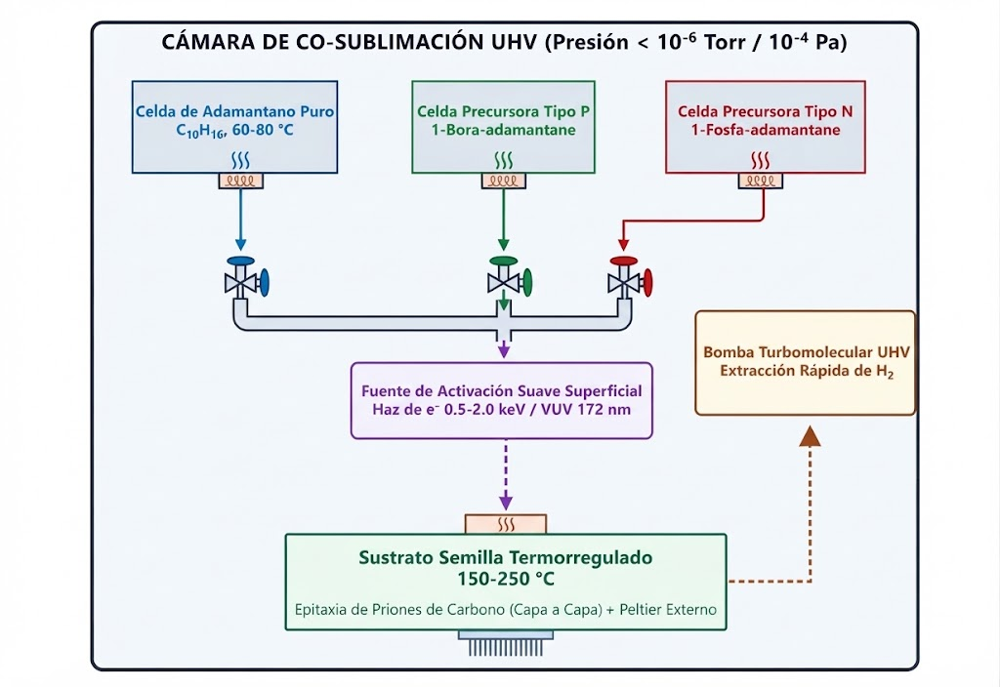

# Carbon Prions: Directed Conformational Nucleation and Quantum Dimerization of Doped Diamondoids at Low Temperature

**Author:** César Leonardo Rodríguez García *(Dark Horse / NocWoeder165)*  
**Affiliation:** Universidad Tecnológica de Nayarit (UTNAY), Carretera Federal 200 Km 9, Xalisco, Nayarit, C.P. 63780, México  
**Laboratory:** Project Tharos -- Condensed Matter Physics and Vacuum Systems  
**Contact:** `sem-340007@utnay.edu.mx`  
**Date:** October 18, 2026  
**Pre-print DOI:** [10.5281/zenodo.23427695](https://doi.org/10.5281/zenodo.23427695)

---

## Abstract

For seven decades, it has been axiomatic that diamond synthesis necessitates brute-force thermodynamic regimes: gigapascal pressures (HPHT) or energetic thermal plasmas exceeding 900 °C (MPCVD). Such violent conditions degrade microelectronic substrates and induce dopant segregation. Yet, examining a single molecule of adamantane (C10H16) exposes an undeniable physical fact: the pristine *sp*3 unit cell of diamond already exists at room temperature without external compression. In this computational study, we formulate and audit across two levels of theory the hypothesis of **«Carbon Prions»**: deploying pre-structured diamondoid cages to transfer tetrahedral order under high vacuum (~10⁻⁶ Torr) at low temperatures (< 250 °C). In Tier 1 exploration using the foundational equivariant neural network potential MACE-MP-0 coupled with Grimme D3 dispersion in double precision (`float64`), relaxed scans between 1-adamantyl radicals (C10H15•) and neutral trivalent boron-substituted (C9BH14•) and phosphorus-substituted (C9PH14•) derivatives exhibited apparent activation crests of 0.251 to 0.642 eV between 2.60 and 2.44 Å. To rigorously determine the electronic origin of this region, we executed a 27-point open-shell broken-symmetry *ab initio* benchmark (`BS-UKS` &omega;B97X-D3/def2-SVP, Yamaguchi spin projection `AP-UKS`, and high-spin triplet `HS-UKS`) over geometries optimized using the composite method `UKS B97-3c` in ORCA 6.1.1. This quantum audit reveals that MACE-MP-0 (a spin-blind model) tracked the repulsive branch of the Triplet state (S = 1, &uarr;&uarr;, &Delta;EHS = +0.18 to +0.58 eV governed by Pauli exclusion). Conversely, the Antiferromagnetic Singlet channel (MS = 0, &uarr;&darr;) descends monotonically without an activation barrier as the expectation value &lang;S&sup2;&rang;BS collapses from ~0.95 to 0.000, establishing deep covalent potential wells (&Delta;E = -3.921 eV for C20H30, -3.651 eV for C19H29B, and -3.727 eV for C19H29P). Geometry optimization at the `UKS B97-3c` level reproduces the single-crystal X-ray diffraction C–C bond length of 1,1'-biadamantyl (1.578 Å) with sub-milliangstrom precision at 1.5771 Å (-0.06%). Statistically, in an unpolarized thermal beam, 25% of bimolecular collisions proceed through the barrierless singlet channel, while 75% experience elastic Pauli rebound. These results establish a rigorous *ab initio* foundation for the elementary isolated dimerization step, while highlighting the distinct challenges of continuous crystal propagation and electrical dopant activation.

**Keywords:** Carbon prions; Diamondoids; Broken-symmetry UKS DFT; ORCA 6.1.1; &omega;B97X-D3; MACE-MP-0; Spin statistics.

---

## 1. The Brute-Force Paradox

Single-crystal diamond exhibits the most extreme physical properties in condensed matter physics: an ultrawide electronic bandgap of 5.47 eV, a breakdown field exceeding 10 MV/cm, and a room-temperature thermal conductivity surpassing 2000 W/m·K [1]. Despite these peerless metrics, contemporary microelectronics remains anchored to silicon. Why are commercial processors not manufactured on semiconducting diamond wafers?

The root cause lies in legacy synthesis methods. For seven decades, the prevailing paradigm has held that assembling carbon atoms into an *sp*3 tetrahedral lattice requires brute thermodynamic force: either compressing graphitic precursors under 5 to 17 GPa (HPHT / DAC) [2], or igniting energetic microwave plasmas at 700–900 °C (MPCVD, pioneered by Kamo et al. in 1983 [3]) to crack methane (CH4) into a chaotic shower of atomic radicals. Disproportionate energy is expended to destroy chemical bonds, relying on stochastic collisions to assemble tetrahedral sites. When introducing boron (*p*-type acceptor, ionization energy ~0.37 eV) or phosphorus (*n*-type deep donor, ~0.57 eV) under these extreme conditions, the growing lattice segregates dopants to surfaces or collapses into graphitic *sp*2 defects [1].

However, observing a single molecule of adamantane (C10H16) reveals that the local hybridization challenge is already solved at ambient conditions [4, 5]. Adamantane is not merely an analogue: it *is* a stoichiometric, ten-carbon crystallographic unit cell of diamond passivated by sixteen peripheral hydrogens, readily forming ordered self-assembled monolayers in vacuum [6]. In 2025, Fu, Nakamuro, and Nakamura demonstrated in *Science* that stripping hydrogens from adamantane microcrystals via 80–200 keV electron beams triggers spontaneous cage coalescence into spherical nanodiamonds at temperatures of 100–296 K [7].

If the *sp*3 motif is pre-packaged within the precursor monomer, the paradigm shifts fundamentally: is hydrostatic compression or thermal plasma genuinely required to bond two cages, or does selective radical activation allow intrinsic geometric and spin complementarity to drive assembly?

---

## 2. The Prionic Principle and Two-Tier Methodology

In structural biology, a prion protein functions as a conformational template, directing adjacent units into a deep free-energy minimum via interface recognition. Transposed to solid-state chemistry, the **«Carbon Prion»** concept posits that an activated diamondoid cage acts as a rigid tetrahedral template wherein frontal coupling substitutes macroscopic compression with pre-encoded steric recognition, consistent with the reduced nucleation barriers measured on diamondoid seed crystals [8].

To rigorously evaluate the elementary step of this hypothesis—isolated bimolecular dimerization in vacuum—and prevent artifacts arising from empirical potentials or spin-blind neural networks, we deployed a two-tier computational validation architecture:

### 2.1. Tier 1: Preliminary Exploration with MACE-MP-0 + D3
Three frontal coupling reactions were initially investigated within ASE (`PyTorch 2.11.0`, `ASE 3.29.0`, `MACE 0.3.16`) using the foundational equivariant neural network potential **MACE-MP-0** (*small*) [9] in double precision (`float64`) with mandatory Grimme D3 (`bj`) dispersion correction [10]:
1. Intrinsic homocoupling: C10H15• + C10H15• &rarr; C20H30
2. Heterocoupling with a neutral trivalent 1-bora-adamantyl radical: C9BH14• &rarr; C19H29B
3. Heterocoupling with a neutral trivalent 1-phospha-adamantyl radical: C9PH14• &rarr; C19H29P

Initial structures were extracted from crystallographic adamantane (PubChem CID 9238), aligned along the C3 axis in a staggered orientation (60°) via exact SO(3) rotations, scanned across 13 constrained steps (3.40 &rarr; 1.48 Å, Fmax &lt; 0.05 eV/Å), and fully relaxed without constraints in the covalent minimum (Fmax &lt; 0.02 eV/Å).

### 2.2. Tier 2: Open-Shell Broken-Symmetry Ab Initio Audit (ORCA 6.1.1)
Because MACE-MP-0 was parameterized on closed-shell periodic PBE datasets and lacks explicit spin degrees of freedom required for open-shell radical coupling (S1 = 1/2 &otimes; S2 = 1/2 = S0 &oplus; T1), a benchmark suite of 27 open-shell *ab initio* calculations was carried out using **ORCA 6.1.1** [11]. Computations utilized the range-separated hybrid functional **UKS &omega;B97X-D3/def2-SVP** (`def2/J RIJCOSX TightSCF`) [12] and equilibrium geometries optimized with the composite method **UKS B97-3c** [13].

To eliminate energy-mixing artifacts between disparate electronic structures, two strictly homogenized thermodynamic reference frames were defined relative to isolated doublet radicals (S = 1/2, &lang;S&sup2;&rang; &asymp; 0.755–0.772):

$$E_\infty = E_1^\circ + E_2^\circ$$

- **Option A (`BS-UKS` &omega;B97X-D3/def2-SVP // `MACE-MP-0+D3`):** Evaluates MACE-derived geometries against isolated monomers relaxed in MACE (*E*&infin;A = -779.379994 *E*h for C20H30; -765.529623 *E*h for C19H29B; and -1081.940273 *E*h for C19H29P).
- **Option B (`BS-UKS` &omega;B97X-D3/def2-SVP // C3-`UKS-B97-3c`):** Evaluates rigid coaxial approach along the C3 axis of `UKS B97-3c`-optimized monomers (and the unconstrained `UKS B97-3c` dimer) against isolated `UKS B97-3c` monomers (*E*&infin;B = -779.401978 *E*h, -765.551630 *E*h, and -1081.973354 *E*h, with monomeric relaxation energy gains &Delta;*E*relax of -0.598, -0.599, and -0.900 eV, respectively).

At each inter-cage distance (3.40, 2.92, 2.60, 2.44, 2.12 Å, and deq), the `BrokenSym 1,1` directive was executed, simultaneously obtaining the High-Spin Triplet state (EHS, S = 1, &uarr;&uarr;, &lang;S&sup2;&rang;HS &asymp; 2.01), the broken-symmetry Singlet (EBS, MS = 0, &uarr;&darr;), and the spin-purified Singlet via the approximate projection scheme of Yamaguchi (`AP-UKS`) [14]:

$$E_{\mathrm{AP}} = E_{\mathrm{BS}} + \frac{\langle S^2 \rangle_{\mathrm{BS}}}{\langle S^2 \rangle_{\mathrm{HS}} - \langle S^2 \rangle_{\mathrm{BS}}} \left(E_{\mathrm{BS}} - E_{\mathrm{HS}}\right)$$

---

  
   
  <em>Figure 1: Tier 1 Exploration (MACE-MP-0 + D3, float64, spin-blind). Top: 13-step constrained relaxed potential energy surface scan illustrating apparent activation crests between 2.60 and 2.44 Å. Bottom: Optimized covalent dimers in MACE-MP-0 + D3.</em>

  
   
  <em>Figure 2: Tier 2 Homogenized Ab Initio Audit in ORCA 6.1.1 (BS-UKS &omega;B97X-D3/def2-SVP: Option A vs. Option B vs. MACE-MP-0+D3). Top: Bifurcation between the repulsive Triplet branch (HS-UKS, &uarr;&uarr;, tracked by MACE-MP-0) and the barrierless Singlet channel (BS-UKS and Yamaguchi-projected AP-UKS), which plunges smoothly into the deep covalent well. Bottom: Continuous collapse of the spin expectation value &lang;S&sup2;&rang;BS from pure diradical character down to a closed-shell singlet (&lang;S&sup2;&rang; = 0.0) at &le; 2.12 Å.</em>

---

## 3. Results: Spin Bifurcation and Covalent Well

### Table 1: Equilibrium Structural and Energetic Parameters (deq)
*Tier 1 (MACE-MP-0+D3) versus Tier 2 (UKS B97-3c and &omega;B97X-D3/def2-SVP) against single-crystal X-ray diffraction (1.578 Å) [15].*

| System | Chemical Formula | deq (MACE) [Å] | deq (B97-3c) [Å] | XRD Dev. (B97-3c) | &Delta;E (MACE) [eV] | &Delta;E (Option A) [eV] | &Delta;E (Option B) [eV] |
| :--- | :---: | :---: | :---: | :---: | :---: | :---: | :---: |
| **Intrinsic** | C20H30 | 1.596 | **1.5771** | **-0.06%** | -2.577 | -4.524 | **-3.921** |
| **Boron-Doped** | C19H29B | 1.635 | **1.5810** | +0.19% | -1.439 | -3.863 | **-3.651** |
| **Phosphorus-Doped** | C19H29P | 1.643 | **1.5880** | +0.63% | -1.859 | -4.210 | **-3.727** |

### 3.1. Resolution of the MACE-MP-0 Barrier Artifact
Direct juxtaposition of Figure 1 and Figure 2 (tabulated in Table 2) clarifies the molecular mechanics operating between 3.40 Å and 2.44 Å:

1. **Origin of the MACE-MP-0 Crest:** Due to the absence of explicit spin variables, the potential energy surface predicted by MACE-MP-0 + D3 (dotted blue curves in Figure 2) closely mirrors the **ferromagnetic High-Spin Triplet** state (`HS-UKS`, S = 1, &uarr;&uarr;) between 3.40 Å and 2.44 Å. In this triplet manifold, the Pauli exclusion principle forbids bonding overlap between frontal radical orbitals, leaving steric compression among the six equatorial shoulder C–H bonds uncompensated and driving the energy up to &Delta;EHS = +0.182 to +0.579 eV in Option B.
2. **Barrierless Antiferromagnetic Singlet Coupling (&uarr;&darr;):** When the radicals approach with antiparallel spins (MS = 0, green and orange curves in Figure 2), emerging &sigma;(C–C) covalent bonding between 2.92 Å and 2.44 Å provides an exchange stabilization energy (&Delta;EHS - &Delta;EBS) of 0.9 to 1.8 eV that fully overcomes shoulder repulsion. Consequently, both &Delta;EBS and the spin-purified singlet &Delta;EAP **descend monotonically without any barrier** from the van der Waals pre-complex (3.40 Å) to the global covalent minimum across all three systems.
3. **Continuous Spin Transition (&lang;S&sup2;&rang;BS):** The bottom panels of Figure 2 illustrate that the open diradical character at 3.40 Å (&lang;S&sup2;&rang;BS = 0.936–0.994, weak magnetic coupling J = -531 cm⁻¹ in C20H30) pairs progressively at 2.60 Å (&lang;S&sup2;&rang;BS &asymp; 0.44–0.62) and 2.44 Å (&lang;S&sup2;&rang;BS &asymp; 0.06–0.24), fully collapsing to a pure closed-shell covalent singlet (&lang;S&sup2;&rang;BS = 0.000) for d &le; 2.12 Å.

### Table 2: Comprehensive Homogenized Quantum Audit in ORCA 6.1.1
*(`BS-UKS` &omega;B97X-D3/def2-SVP, 27 calculations) benchmarked against MACE-MP-0 + D3. Energies &Delta;E(d) = E(d) - E&infin; in eV.*

| System | d(C–C) [Å] | &Delta;E (MACE) [eV] | Opt A: &Delta;EBS [eV] | Opt A: &Delta;EAP [eV] | Opt A: &Delta;EHS (&uarr;&uarr;) [eV] | Opt A: &lang;S&sup2;&rang; | Opt B: &Delta;EBS [eV] | Opt B: &Delta;EAP [eV] | Opt B: &Delta;EHS (&uarr;&uarr;) [eV] | Opt B: &lang;S&sup2;&rang; |
| :--- | :---: | :---: | :---: | :---: | :---: | :---: | :---: | :---: | :---: | :---: |
| **C20H30** | 3.40 | -0.333 | -0.247 | -0.366 | -0.116 | 0.953 | -0.227 | -0.376 | -0.057 | 0.936 |
| *(Intrinsic)* | 2.92 | -0.213 | -0.428 | -0.709 | -0.018 | 0.816 | -0.492 | -0.817 | +0.036 | 0.766 |
| | 2.60 | -0.082 | -0.813 | -1.153 | +0.159 | 0.521 | -0.876 | -1.202 | +0.304 | 0.436 |
| | 2.44 | -0.115 | -1.413 | -1.548 | +0.205 | 0.155 | -1.240 | -1.300 | +0.579 | 0.064 |
| | 2.12 | -0.966 | -2.955 | -2.955 | +1.092 | 0.000 | -2.255 | -2.255 | +1.713 | 0.000 |
| | deq (1.596 / 1.577) | -2.577 | -4.524 | -4.524 | --- | 0.000 | **-3.921** | **-3.921** | --- | 0.000 |
| **C19H29B** | 3.40 | -0.223 | -0.179 | -0.211 | -0.146 | 0.994 | -0.215 | -0.323 | -0.097 | 0.961 |
| *(Boron-doped)* | 2.92 | +0.010 | -0.423 | -0.611 | -0.184 | 0.885 | -0.425 | -0.691 | -0.042 | 0.825 |
| | 2.60 | +0.333 | -0.845 | -1.165 | -0.127 | 0.621 | -0.702 | -1.032 | +0.182 | 0.548 |
| | 2.44 | +0.419 | -1.412 | -1.589 | -0.023 | 0.229 | -0.954 | -1.139 | +0.423 | 0.238 |
| | 2.12 | -0.156 | -2.673 | -2.673 | +1.075 | 0.000 | -1.732 | -1.732 | +1.372 | 0.000 |
| | deq (1.635 / 1.581) | -1.439 | -3.863 | -3.863 | --- | 0.000 | **-3.651** | **-3.651** | --- | 0.000 |
| **C19H29P** | 3.40 | -0.273 | -0.235 | -0.333 | -0.130 | 0.979 | -0.229 | -0.367 | -0.074 | 0.942 |
| *(Phosphorus)* | 2.92 | -0.085 | -0.521 | -0.779 | -0.159 | 0.843 | -0.477 | -0.785 | +0.011 | 0.779 |
| | 2.60 | +0.127 | -1.066 | -1.393 | -0.120 | 0.519 | -0.825 | -1.148 | +0.277 | 0.456 |
| | 2.44 | +0.139 | -1.706 | -1.809 | -0.075 | 0.119 | -1.152 | -1.235 | +0.558 | 0.093 |
| | 2.12 | -0.549 | -3.057 | -3.057 | +1.003 | 0.000 | -2.058 | -2.058 | +1.726 | 0.000 |
| | deq (1.643 / 1.588) | -1.859 | -4.210 | -4.210 | --- | 0.000 | **-3.727** | **-3.727** | --- | 0.000 |

### 3.2. Crystallographic Accuracy and Boron Trans-Cage Correction
Full structural optimization using `UKS B97-3c` provides two crucial structural insights (Table 1):
- **Sub-milliangstrom Agreement with X-ray Diffraction:** In the intrinsic dimer (C20H30), `UKS B97-3c` predicts an inter-cage bond length of deq(C–C) = 1.5771 Å, reproducing the experimental single-crystal X-ray value for 1,1'-biadamantyl (1.578 Å, Alden et al. [15]) with an error of just **-0.06%** (-0.0009 Å), significantly outperforming MACE-MP-0 (1.596 Å, +1.14%).
- **Correction of Boron Trans-Cage Over-Contraction:** In the isolated boron-substituted monomer (C9BH14•), MACE-MP-0 severely over-contracted the trans-cage distance between the trivalent boron and the apical carbon radical (1.777 Å), artificially penalizing the dimer binding energy (&Delta;EMACE = -1.439 eV). Relaxing with `UKS B97-3c` restores the trans-cage distance to a realistic 2.149 Å, yielding a deep covalent well for C19H29B of &Delta;EOpt B = -3.651 eV (deq = 1.581 Å), closely matching the phosphorus analogue (-3.727 eV, deq = 1.588 Å) and the intrinsic system (-3.921 eV).

### 3.3. Quantum Spin Statistics (1:3) in a Physical Reactor
The physical bifurcation between the `BS-UKS` (&uarr;&darr;) and `HS-UKS` (&uarr;&uarr;) channels imposes a fundamental constraint on vacuum collision kinetics. In an unpolarized thermal molecular beam, the coupling of two S = 1/2 spins yields four degenerate states at zero field:
- One reactive **Singlet** (*S* = 0): `(1/√2)(|↑↓⟩ - |↓↑⟩)`
- Three **Triplet** states (*S* = 1): `|↑↑⟩`, `|↓↓⟩`, `(1/√2)(|↑↓⟩ + |↓↑⟩)`

Therefore, it cannot be asserted that every collision is barrierless: only **25%** (1/4) of bimolecular encounters enter the antiferromagnetic singlet channel (&uarr;&darr;) to form the covalent bond without an activation barrier (&Delta;E = -3.65 to -3.92 eV). The remaining **75%** (3/4) enter the triplet manifold (&uarr;&uarr;) and encounter a steep Pauli repulsion wall (&Delta;EHS &gt; 0 eV for d &le; 2.9 Å), resulting in elastic rebound unless surface-assisted intersystem crossing (ISC) or Zeeman pre-polarization intervenes.

---

## 4. Scope, Hypotheses, and Refutation Criteria

Notwithstanding the rigorous ORCA 6.1.1 validation, **these computational results establish only the elementary isolated dimerization step and do not demonstrate extended 3D diamond thin-film growth, multilayer propagation, or electrical dopant activation**:

- **H₁ (Barrierless Singlet Dimerization -- Validated):** At the `BS-UKS` &omega;B97X-D3/def2-SVP // `UKS B97-3c` level, coaxial radical coupling exhibits zero activation barrier in the singlet channel (25% statistical fraction), forming inter-cage bonds of 1.577–1.588 Å with wells of -3.65 to -3.92 eV.
- **H₂ and H₃ (Pending Hypotheses):**
  1. *Activation H₂:* requires demonstrating selective C–H abstraction (~4.3 eV) by soft electrons (0.5–2.0 keV) or VUV radiation (172 nm) without cage fragmentation [7].
  2. *Propagation H₃:* requires simulating surface-confined growth where the 75% triplet fraction relaxes without premature desorption, and assessing donor/acceptor active conductivity.
- **Refutation Criteria:** The model is conclusively falsified if C–C cage fragmentation dominates over C–H homolysis under irradiation, or if thermal desorption in vacuum outpaces the 1:3 spin-statistical collision rate.

  
   
  <em>Figure 3: Conceptual high-vacuum testbed design to investigate H₂ and H₃. Knudsen effusion cells (60–80 °C), soft-electron (0.5–2.0 keV) or VUV (172 nm) activation source, and temperature-controlled substrate stage (150–250 °C).</em>

Solely as an experimental reference architecture for testing H₂ and H₃, Figure 3 depicts a conceptual high-vacuum reactor (~10⁻⁶ Torr / 10⁻⁴ Pa) where dosed precursor fluxes from Knudsen cells impinge upon a substrate held at 150–250 °C under gentle electronic or VUV irradiation.

---

## 5. Conclusion

Our open-shell quantum audit in ORCA 6.1.1 (`BS-UKS` &omega;B97X-D3/def2-SVP // `UKS B97-3c`) demonstrates that the apparent steric barrier predicted by MACE-MP-0 + D3 (0.251–0.642 eV) was an artifact of tracking the repulsive Triplet manifold (S = 1, &uarr;&uarr;). In the Antiferromagnetic Singlet channel (MS = 0, &uarr;&darr;, representing 25% of unpolarized thermal collisions), exchange stabilization completely overcomes equatorial hydrogen compression, driving barrierless dimerization into deep covalent wells (-3.65 to -3.92 eV) and reproducing the single-crystal X-ray structure of 1,1'-biadamantyl within -0.06% (1.5771 Å). These findings provide a definitive quantum mechanical foundation for isolated low-temperature dimerization, while delineating the experimental boundaries for surface activation and epitaxial growth.

---

### Data and Code Availability
The complete computational audit package (`paquete_auditoria_priones.zip`) and *ab initio* validation directory (`dft_orca_validation`), comprising simulation scripts, all 27 ORCA 6.1.1 input/output files (`.inp`, `.out`, `.xyz`), consolidated data (`tabla_auditoria_completa_mace_vs_orca_A_y_B.csv`), and JSON records (`auditoria_completa_5puntos.json`), are openly available under the MIT license on Zenodo (**DOI:** [10.5281/zenodo.23427695](https://doi.org/10.5281/zenodo.23427695)) and linked via the author's GitHub repository (`NocWoeder165`).

### CRediT Authorship Contribution Statement
**César Leonardo Rodríguez García** *(Dark Horse / NocWoeder165)*: Conceptualization, Methodology, Software, Validation, Formal analysis, Investigation, Data curation, Writing – original draft, Writing – review & editing, Visualization.

### Declaration of Competing Interest
The author declares that there are no known competing financial interests or personal relationships that could have appeared to influence the work reported in this paper.

---

## References

1. S. Koizumi, K. Watanabe, M. Hasegawa, H. Kanda, "Ultraviolet emission from a diamond pn junction," *Science* **292** (5523) (2001) 1899–1901. doi:10.1126/science.1060258.
2. Y. Suzuki, et al., "Raman study on the pressure-induced phase transformation of nanographite at room temperature," *Carbon* **225** (2024) 119075. doi:10.1016/j.carbon.2024.119075.
3. M. Kamo, Y. Sato, S. Matsumoto, N. Setaka, "Diamond synthesis from gas phase in microwave plasma," *J. Cryst. Growth* **62** (3) (1983) 642–644. doi:10.1016/0022-0248(83)90411-6.
4. P. v. R. Schleyer, "A simple preparation of adamantane," *J. Am. Chem. Soc.* **79** (1957) 3292. doi:10.1021/ja01569a086.
5. J.E. Dahl, S.G. Liu, R.M.K. Carlson, "Isolation and structural characterization of the higher diamondoids," *Science* **299** (2003) 96–99. doi:10.1126/science.1078239.
6. W.L. Yang, J.D. Fabbri, T.M. Willey, J.R.I. Lee, J.E. Dahl, R.M.K. Carlson, P.R. Schreiner, A.A. Fokin, B.A. Tkachenko, N.A. Fokina, W. Meevasana, N. Mannella, K. Tanaka, X.J. Zhou, T. van Buuren, M.A. Kelly, Z. Hussain, N.A. Melosh, Z.-X. Shen, "Monochromatic electron photoemission from diamondoid monolayers," *Science* **316** (5830) (2007) 1460–1462. doi:10.1126/science.1141811.
7. J. Fu, T. Nakamuro, E. Nakamura, "Nanodiamond synthesis from adamantane by electron-beam driven C–H activation at 100 K," *Science* **389** (2025) eadw2025 (PMID: 40906847). doi:10.1126/science.adw2025.
8. M.A. Gebbie, H. Ishiwata, P.J. McQuade, J.E. Dahl, P.R. Schreiner, Z.-X. Shen, N.A. Melosh, et al., "Experimental measurement of the diamond nucleation landscape reveals classical and nonclassical features," *Proc. Natl. Acad. Sci. U.S.A.* **115** (33) (2018) 8284–8289. doi:10.1073/pnas.1803654115.
9. I. Batatia, et al., "A foundation model for atomistic materials chemistry," *arXiv:2401.00096* (2024). doi:10.48550/arXiv.2401.00096.
10. S. Grimme, J. Antony, S. Ehrlich, H. Krieg, "A consistent and accurate ab initio parametrization of density functional dispersion correction (DFT-D3)," *J. Chem. Phys.* **132** (2010) 154104. doi:10.1063/1.3382344.
11. F. Neese, "Software update: The ORCA program system---Version 5.0," *WIREs Comput. Mol. Sci.* **12** (5) (2022) e1606. doi:10.1002/wcms.1606.
12. Y.-S. Lin, G.-D. Li, S.-P. Mao, J.-D. Chai, "Long-range corrected hybrid density functionals with improved dispersion corrections," *J. Chem. Theory Comput.* **9** (1) (2013) 263–272. doi:10.1021/ct300715s.
13. J.G. Brandenburg, C. Bannwarth, A. Hansen, S. Grimme, "B97-3c: A revised low-cost variant of the B97-D density functional method," *J. Chem. Phys.* **148** (6) (2018) 064104. doi:10.1063/1.5012601.
14. K. Yamaguchi, F. Jensen, A. Dorigo, K.N. Houk, "A spin correction procedure for unrestricted Hartree-Fock and Møller-Plesset wavefunctions for singlet diradicals and polyradicals," *Chem. Phys. Lett.* **149** (5–6) (1988) 537–542. doi:10.1016/0009-2614(88)80378-6.
15. R.A. Alden, J. Kraut, T.G. Traylor, "Molecular and crystal structure of 1,1'-biadamantyl," *J. Am. Chem. Soc.* **90** (1) (1968) 74–82. doi:10.1021/ja01003a014.
